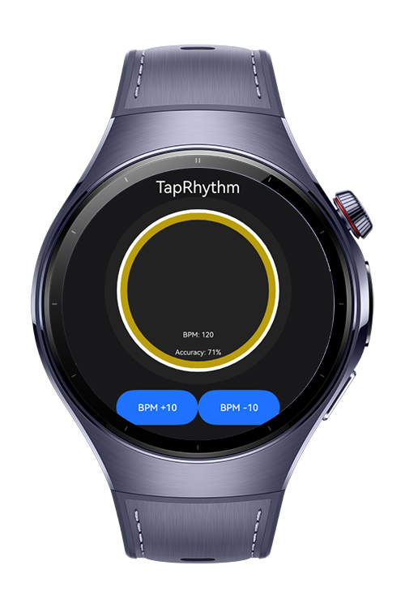
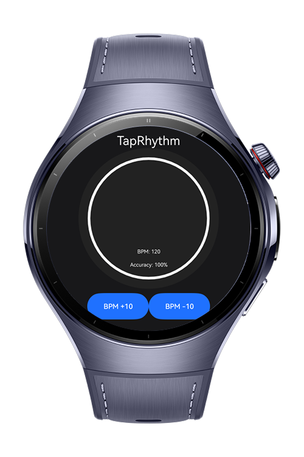
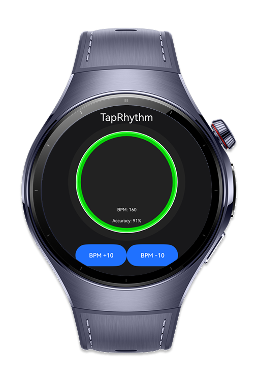
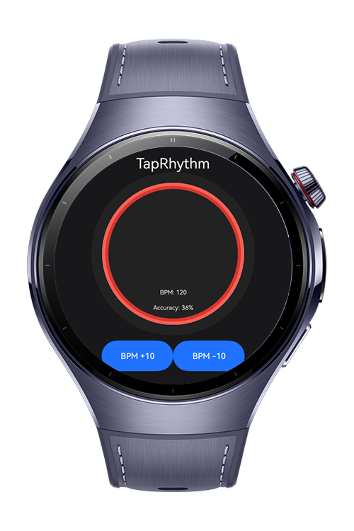

> **Note:** To access all shared projects, get information about environment setup, and view other guides, please visit [Explore-In-HMOS Index](https://github.com/Explore-In-HMOS/hmos-index).

# TapRhythm
TapRhythm is a wearable rhythm-training app designed to help users improve their timing accuracy.
By tapping the screen in rhythm, users can practice staying on beat while the app calculates:
# Preview

<div style="display:flex;  align : left;">






</div>

# Use Cases
Users can use this application to training for rhythm.
# Tech Stack

- **Languages**: ArkTS, ARKUI
- **Frameworks**: HarmonyOS SDK 5.1.0(18)
- **Tools**: DevEco Studio Vers 5.1.0.842
- **Libraries**:
    - @kit.ArkUI
    - @kit.NotificationKit
    - @kit.BasicServicesKit
    - @kit.AbilityKit
    - Canvas (ArcGraphic)
    - Ohpm Libwlmedia

# Directory Structure

```
├───entryability
│       EntryAbility.ets
│
├───entrybackupability
│       EntryBackupAbility.ets
│
├───model
│       AudioModel.ets
│       RhythmModel.ets
│       VibratorModel.ets
│
├───pages
│       Index.ets
│
├───utils
│       FileUtil.ets
│
└───viewmodel
        TapRhythmViewModel .ets

```
# Constraints and Restrictions

## Supported Devices

- Huawei Watch 5

# LICENSE

TapRhythm is distributed under the terms of the MIT License.
See the [LICENSE](./LICENSE) for more information.